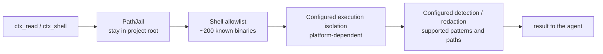

# Journey 13 — Security & Governance

> You're putting lean-ctx in front of real code — possibly on a shared machine,
> in CI, or under a security policy. This journey covers supported controls
> and their configuration boundaries: filesystem jail, shell
> allowlist, secret redaction, OS sandboxing, harden mode, and role policies.

Source files:
- `rust/src/core/pathjail.rs` — filesystem boundary (PathJail)
- `rust/src/core/shell_allowlist.rs` — command allowlist
- `rust/src/core/secret_detection.rs` — secret scanning & redaction
- `rust/src/core/sandbox.rs`, `sandbox_seatbelt.rs`, `sandbox_landlock.rs` — OS sandbox
- `rust/src/core/tcc_guard_sandbox.rs` — macOS launchd seatbelt wrapper (deny `~/Documents`, #356)
- `rust/src/cli/harden.rs` — `harden` (soft/hard/undo)
- `rust/src/core/context_policies.rs` — role policies
- `rust/src/core/owasp_alignment.rs`, `audit_trail.rs` — alignment & audit

---

## 0. The defense-in-depth model

Supported paths apply layered controls according to the integration, role,
configuration, and platform. The diagram names the layers; it does not assert
that every path traverses every layer or that all layers are enabled:



Review the effective posture with `lean-ctx security status` and `lean-ctx doctor`.
Allow roots, roles, warning modes, and disabled controls can widen the boundary.

---

## 0.1 See and flip the whole posture — `lean-ctx security`

lean-ctx's guardrails fall into **two independent planes**. Keeping them separate
is deliberate: changing containment does not itself change secret-redaction
configuration. Detection still has coverage limits and cannot guarantee that
no secret reaches a model provider.

| Plane | Protects | Controls |
|-------|----------|----------|
| **Containment** | your *machine* from the agent | PathJail + shell gating |
| **Secret defense** | your *secrets* from the LLM provider | `.env` / credential redaction |

One command shows the live posture and how to change it:

```bash
lean-ctx security status        # posture board: jail, shell, secret redaction
```

Two master switches flip **containment** in one step — secret redaction is never
touched by them:

```bash
lean-ctx yolo                   # OPEN: any path + any command (containment off)
lean-ctx secure                 # STRICT: restore the secure defaults
```

`yolo` writes `path_jail = false` and `shell_security = "off"` to your global
config and takes effect immediately (no restart). It is fully reversible, and you
re-enable pieces **granularly** afterwards — the array/blanket dichotomy works in
both directions:

```bash
lean-ctx config set shell_security warn   # log violations, block nothing
lean-ctx config set path_jail true        # re-enable the filesystem jail
lean-ctx allow acli                       # permit one extra command (additive)
```

Secret/`.env` redaction is a **separate** toggle — `yolo` leaves it on:

```bash
lean-ctx security secrets off   # stop masking secrets (NOT recommended)
lean-ctx security secrets on    # re-enable masking
```

`lean-ctx security status` (and `lean-ctx doctor`) print a coarse label —
**STRICT** (both planes enforced), **RELAXED** (partially loosened), or **OPEN**
(containment fully off) — so the active posture can never hide.

> Mental model: **containment** is "what the agent may touch on this machine";
> **secret defense** is "what may leave this machine for the provider". `yolo`
> only drops the first.

---

## 1. PathJail — your projects, not your secrets

**What it does:** confines lean-ctx's file tools to your own files. The default
scope is **`projects`**: every project below your home directory is
**readable**, so working across several repositories needs no configuration,
while **writes** stay in the session's project, host-declared roots and allowed
paths. With `path_jail_scope = home` everything below `~` is readable and
writable (the default of v3.11.3–v3.12.0). What stays jailed entirely:

| Zone | Examples | Why |
|------|----------|-----|
| Top-level dot entries in `~` | `~/.ssh`, `~/.aws`, `~/.gnupg`, `~/.config`, `~/.zshrc`, `~/.claude`, `~/.codex`, `~/.cursor` | credentials, shell startup files, other agents' sessions |
| OS app-data stores | `~/Library` (macOS), `~/AppData` + `NTUSER.DAT*` (Windows), `~/snap` (Linux) | keychains, browser profiles, mail |
| Everything outside `~` | `/etc`, `/opt`, `/srv`, `/tmp` | system files, other users |

A dot entry *inside* a project (`repo/.git`, `repo/.github`) is ordinary code.
Protected zones are a hard deny: a project root or allow entry that merely
*contains* one (a dotfiles repo at `~`, an `extra_roots = ["~"]`) does not open
it — only a root or allow entry *inside* the zone does (`~/.codex/worktrees/x`,
`lean-ctx allow-path ~/.config/myapp`). Path traversal (`../../`) and symlinks
are resolved before every check. If `$HOME` is implausible (`/`, a single
component like `/root` or `/tmp`, or not owned by you), the `projects` and
`home` scopes stay off and the project boundary applies.

- **Default (read other projects, write only the active one, loose personal
  files jailed):** `path_jail_scope = projects` stops a prompt-injected agent in
  repo A from planting `~/code/B/.git/hooks/pre-commit` or reading
  `~/Documents/taxes.pdf`.
- **All of `~`, read and write:** `lean-ctx config set path_jail_scope home` —
  the default of v3.11.3–v3.12.0; `lean-ctx doctor` lists it as a relaxation.
- **Classic single-project boundary:** `lean-ctx config set path_jail_scope project`
  confines tools to the active project plus your allow-lists.
- **Open one more directory:** `lean-ctx allow-path <dir>` — read *and* write
  for a directory outside `~` (`/opt/src/sdk`), a sibling project you want to
  edit, or one protected location (`~/.config/myapp`). Takes effect immediately;
  no restart. `--list` / `--remove` manage entries; it refuses `/`, `~` and any
  directory containing `~`. (`allow_paths`, `extra_roots` and `read_only_roots`
  in config.toml still work.)
- **Disable it (blanket):** `path_jail = false` allows *any* path — for
  containers/sandboxes where the boundary is already external. `lean-ctx yolo`
  sets this for you, and `lean-ctx doctor` flags it loudly while it is active.
- `path_jail_scope` is **global-only**: a cloned repo's `.lean-ctx.toml` cannot
  change it.

**Project binding is per session.** Each agent session binds to the project it
was started in — the host's workspace roots, its project env (`CLAUDE_PROJECT_DIR`,
…) or the working directory. A `LEAN_CTX_PROJECT_ROOT` pin in an agent's *global*
MCP config used to bind every session of that agent to one repository (and was
written by older `setup` runs). lean-ctx no longer writes it, removes it on the
next agent refresh, and `lean-ctx doctor` reports any left (`doctor --fix`
removes them). If a stale pin is still present, a session started inside a
different real project uses that project anyway.

**When a path is refused**, the error names the one command that fixes it — e.g.
`lean-ctx allow-path /opt/src/sdk` — for you to run in your terminal (agent
shells refuse it, see §2); it takes effect without a restart.

This is the foundation every other layer assumes.

---

## 1.5 Workspace trust — gate untrusted project-local config

**What it does:** a cloned repo ships its own `.lean-ctx.toml`, which is merged
over your global config. That merge can raise **security-sensitive** settings —
replace the `shell_allowlist`, widen the jail via `allow_paths` / `extra_roots`,
repoint a `proxy.*_upstream`, define `custom_aliases`, or flip
`rules_scope` / `rules_injection`. lean-ctx treats those as *trusted-only*.

For a workspace you have **not** trusted, the sensitive overrides are **withheld**
(comfort knobs like `compression_level` / `theme` still apply) and a `[SECURITY]`
warning is logged. Grant trust explicitly:

```bash
lean-ctx trust              # trust the current project root
lean-ctx trust status       # show trust state + which overrides are gated
lean-ctx trust --list       # list all trusted workspaces
lean-ctx untrust            # revoke trust for the current root
```

Trust is pinned to **both** the workspace path **and** a content hash of
`.lean-ctx.toml` — editing the file after trust re-gates it, so a "trust once,
modify later" change can't take effect silently. `lean-ctx doctor` shows the
state. Headless / fleet environments can opt in without a prompt via
`LEAN_CTX_TRUST_WORKSPACE=1` or a `LEAN_CTX_TRUSTED_ROOTS=/path/a,/path/b` list.

> Review a clone's `.lean-ctx.toml` before you `lean-ctx trust` it — trusting is
> what lets its security-sensitive settings widen lean-ctx's own boundaries.

---

## 1.6 Launcher-bound Workspace — exactly these roots, per server

**What it does:** an agent host that runs several projects side by side (or
attaches folders to a running agent) needs each MCP server to reach *exactly*
its own roots, and to lose a root the moment it is detached. The PathJail scope,
`extra_roots`/`allow_paths` and client-reported roots are process-wide or chosen
by the client, so they cannot express that. A Workspace can.

The **launcher** (not the client, not the model) starts the MCP server with
`LEAN_CTX_WORKSPACE_FILE=<absolute path>`. The file names one Workspace: a
primary root, up to 64 additional roots (read-write or read-only) and a
revision. `/`, the home directory and its ancestors, and agent config
directories are refused as roots.

```bash
lean-ctx workspace create --file ~/ws/app.json --id app ~/code/app
lean-ctx workspace add    --file ~/ws/app.json --expect-revision 1 --read-only ~/code/shared-lib
lean-ctx workspace show   --file ~/ws/app.json          # revision 2
lean-ctx workspace remove --file ~/ws/app.json --expect-revision 2 ~/code/shared-lib
lean-ctx workspace diagnose                             # what this process is bound to
```

While a server is bound:

- **Only the Workspace's roots** are reachable by every tool path, MCP
  resource, search index, response cache and repo root — lean-ctx's own data
  and state directories (every project's indexes and sessions) included: their
  content comes only through engine tools such as `ctx_expand`. The
  `home`/`projects` scope, `allow_paths`, `extra_roots`, `read_only_roots`,
  `LEAN_CTX_ALLOW_PATH`/`LEAN_CTX_EXTRA_ROOTS`, auto-admitted cache folders and
  `path_jail = false` grant nothing.
- **Client metadata never selects authority:** MCP `roots/list`, Cursor's
  workspace folders, `ctx_multi_repo add_root`/`save_config` (and roots already
  saved there) and absolute paths cannot move or widen the session. The session's project is the primary root.
- **Each tool call takes one snapshot.** A root detached with
  `workspace remove` is gone on the server's next call — no restart; a search
  index of a detached root serves nothing. A call already running finishes on the
  revision it started with.
- **Writes need a read-write root;** `--read-only` roots are readable only.
- **Fail closed:** a missing, malformed or insecurely stored file denies every
  path (it never falls back to the legacy roots). The file must be a regular
  file (not a symlink) owned by the server's user with mode `0600`, in
  directories no other user can write (sticky directories excepted), and it
  must lie **outside** every root of its Workspace and outside lean-ctx's own
  directories — otherwise the agent could edit its own authority. On Windows
  ownership cannot be verified yet, so a configured Workspace denies every path
  there. A recorded root that is deleted or replaced by a
  symlink grants nothing until it is that directory again.
- **Compare-and-swap:** `add`/`remove` require `--expect-revision`; a stale
  revision is refused, so two launchers cannot overwrite each other. Changes are
  written atomically under an exclusive lock.
- Agent shells cannot run `workspace create`/`add` (§2); `remove`, `show` and
  `diagnose` stay available. `lean-ctx security` and `ctx_session status` show
  the binding.

**Limits:** a Workspace bounds lean-ctx's tools. Commands that `ctx_shell` runs
are processes of their own: the Workspace bounds their working directory and
output capture, not what a command itself opens or renames (a command could
also rewrite a Workspace file the server's user owns, or move a read-only root
nested in a read-write one) — use the shell allowlist (§2) and OS sandboxing
(§3) for that, and keep the file where the agent's user cannot write. One server serves one Workspace; a shared HTTP
daemon is bound to the Workspace of its own process. Without
`LEAN_CTX_WORKSPACE_FILE` nothing changes.

---

## 2. Shell allowlist & strict mode

**What it does:** the shell hook only compresses/executes commands whose
tokens match an allowlist entry (~200 common dev tools by default: `git`,
`cargo`, `npm`, `node`, `python`, …). Anything else passes through untouched
rather than being wrapped.

Entry grammar (`shell_allowlist_subcommand_scoping = true`, the default):
- A single word (`"cargo"`) matches the binary plus any subcommand/args.
- A multi-word entry with no trailing `*` (`"git status"`) matches that
  exact command only — `git stash` needs its own entry.
- A multi-word entry ending in `*` (`"terraform plan *"`) matches that
  subcommand plus any (or no) further arguments.

Set `shell_allowlist_subcommand_scoping = false` to fall back to matching
only the base binary (the behavior before this grammar existed) as a
compat/rollback path; a trusted workspace only, since it widens access.

**No self-loosening (since v3.11.1).** `lean-ctx` itself is allowlisted, but the
subcommands that widen its guardrails are refused from agent shells (ctx_shell
and hook-rewritten Bash): `yolo`, `allow <cmd>`, `allow-path <dir>`, `trust`,
`security open`, `security secrets off`, and `config set` of a security, path or
allowlist key. Otherwise an agent could undo the refusal it just received.
Listing (`--list`, `status`, `config show`), narrowing (`--remove`) and tightening
(`secure`, `untrust`, `security secrets on`) still work. Run the blocked commands
in your own terminal.

**`ctx_execute` follows the same gate.** Shell code in `ctx_execute`
(`language` `shell`, `bash` or `sh`) is checked by the same allowlist as
`ctx_shell`, self-loosening refusal included, before anything runs. Code in
another language cannot be read by the allowlist, so under
`shell_security = "enforce"` it runs only after you approve it in your AI
tool's approval dialog, or when its language is in `execute_allowed_languages`
(global config). An approved script has the reach of its interpreter; deny the
tool by role where that matters.

**Pipelines & chains (`|`, `&&`, `||`, `;`):** a compound command is wrapped as a
*single* `lean-ctx -c "<whole>"` only when **every** stage is gate-clean — then
the pipe/chain runs natively inside one profile-free shell and just the *final*
output is compressed (so `git log | wc -l` counts the raw log, not a digest). If
any stage is not gate-clean (an interpreter `-c`, a non-allowlisted sink such as
`kubectl`, …) the **whole** command is left raw for the agent's shell. lean-ctx
never wraps only part of a pipe (which would compress mid-pipe data the next stage
still needs) and never relaxes the gate to wrap a tricky sink — the rewrite can
only ever route commands the same chokepoint would already allow.

```toml
# config.toml
shell_allowlist = ["git", "cargo", "npm", "…"]   # REPLACE the default set
shell_allowlist_extra = ["just", "task"]          # ADD to the default set
shell_strict_mode = false                         # set true to block $() and backticks
excluded_commands = []                            # never intercept these
```

- **`docker` / `podman` are deliberately *not* in the default allowlist** —
  mount flags can bypass PathJail. Add them explicitly only if you accept that.
- `shell_strict_mode = true` blocks command substitution (`$(…)`, backticks) for
  environments that must forbid dynamic command construction.
- Replace the whole list via `LEAN_CTX_SHELL_ALLOWLIST` (comma-separated), or
  just **add** a few extras with `shell_allowlist_extra`. The
  `lean-ctx allow <cmd>` CLI edits `shell_allowlist_extra` for you, and
  `lean-ctx allow --list` prints the effective allowlist plus any parse errors so
  a typo can never silently drop your overrides.

### 2.1 Shell-security mode (`enforce` | `warn` | `off`)

One switch governs **all** command gating — the allowlist *and* the hard blocks
(`eval`/`exec`/`source`, `$()`/backticks at command position, interpreter `-c`).
It is applied at a single chokepoint, so MCP `ctx_shell` and the CLI
(`lean-ctx -c` / `-t`) behave identically.

```toml
# config.toml
shell_security = "enforce"   # default — secure
# shell_security = "warn"    # run the checks, log violations via tracing, never block
# shell_security = "off"     # skip command gating entirely — compression stays active
```

| Mode | Allowlist | Hard blocks (`eval`, `$()`, …) | Compression |
|---|---|---|---|
| `enforce` (default) | enforced | blocked | on |
| `warn` | logged only | logged only | on |
| `off` | skipped | skipped | **on** |

- **Resolution:** `LEAN_CTX_SHELL_SECURITY` env → `shell_security` in config →
  default `enforce`. An unknown value falls back to `enforce` (never fails open).
- **Why `enforce` is the default, even for beginners:** lean-ctx mediates the
  agent's shell, so a weaker default would silently downgrade security for every
  install on upgrade. In practice the default allowlist already covers normal
  workflows (`git`/`cargo`/`npm`/`node`/`python`/…), so beginners rarely hit it —
  the friction is for power users running exotic tools, who opt into `off`.
- **`off` is the "YOLO" escape hatch.** It disables *command gating* only; it does
  **not** lift the read-only-output doctrine in `ctx_shell` (no `>`/`tee`/heredoc
  file writes — use the native write tool). Compression is unaffected in every mode.
  Set it together with `path_jail = false` in one step via `lean-ctx yolo`
  (and revert both with `lean-ctx secure`).
- `lean-ctx doctor` surfaces the active mode whenever it is not `enforce`, so a
  relaxed posture can never hide.
- This supersedes the CLI-only `LEAN_CTX_ALLOWLIST_WARN_ONLY` (which still works
  for backward compatibility); `shell_security` is the canonical, global switch.

### 2.2 Approving a command outside the allowlist (`shell_approval`)

When `ctx_shell` would refuse a command **only** because programs in it are not
on the allowlist, lean-ctx asks you instead, in your AI tool's own approval
dialog (MCP form elicitation):

| Choice | Effect |
|---|---|
| **Allow once** | This one command runs. The next one asks again. |
| **Allow for this session** | These programs run without asking until the MCP session ends. |
| **Always allow** | Adds the programs to `shell_allowlist_extra`, exactly like `lean-ctx allow`. |
| **Deny** | The command does not run, and the agent is told you declined. These programs are not asked about again in this session. |

- **Hard blocks are never asked about.** `eval`/`exec`/`source`, `$()`/backticks
  at command position, inline interpreter code (`python -c`, heredocs), dangerous
  flags, unconditionally blocked programs, destructive PowerShell cmdlets,
  commands that reconfigure lean-ctx and redaction markers are refused as before.
- **An approval names programs, not commands.** The command is checked again
  with exactly the approved programs counted as listed, so every other check
  still decides. Approving `python3` never admits `python3 -c …`.
- **Some approvals are once only.** A grant matches a program by name, so a
  session or permanent approval is not offered for a program named by path
  (`/opt/bin/probe`), an interpreter or shell (`python3`, `bash`, …, which would
  run any script the agent writes next), a subcommand-scoped program (an entry
  like `terraform plan *`), or a command too long to show in full.
- **What you read is what runs.** The prompt names the programs first and shows
  the command on one line, with newlines as `⏎` and invisible or control
  characters (ANSI escapes, bidi overrides, zero-width characters) spelled out as
  `\u{…}`. Nothing is preselected, so a client that submits defaults on its own
  approves nothing. Program names other than plain names (letters, digits, `._+-`)
  are never asked about.
- **Codex** shows its own approve/deny dialog; approving there allows the command once.
- **No dialog, no change:** a client without form elicitation, a prompt that
  fails or is not answered within about two minutes, or `shell_security` other
  than `enforce` keeps the earlier behaviour. One prompt is open at a time (a
  second command meanwhile is refused as before, not queued), and prompts are
  limited to six per ten minutes per session.
- **Known limit:** `ctx_shell`'s own output-capture rules (no `>`/`tee` into
  files) are checked after the prompt, so an approved command can still be
  refused for writing a file.
- **Proof:** every answer is written to the audit trail (`shell_approval:<choice>`
  with the programs and a digest of the command, never the command itself).
- **Off switch:** `shell_approval = "off"` in the global config, or
  `LEAN_CTX_SHELL_APPROVAL=off`. A project's `.lean-ctx.toml` cannot change it.

### 2.3 Approving `ctx_execute` code

`ctx_execute` code in any language other than shell (python, javascript,
typescript, ruby, go, rust, php, perl, r, elixir) runs only after you approve
it, through the same dialog and with the same choices. Shell code
(`shell`/`bash`/`sh`) follows the shell allowlist instead.

- **An approval names a language.** "Allow for this session" covers any code in
  that language until the MCP session ends; "Always allow" adds the language to
  `execute_allowed_languages` in the global config. Approving `python` never
  approves `javascript`, and neither approves anything in `ctx_shell`.
- **Batches** ask once per language in the batch; denying any one refuses the
  whole batch before any item runs.
- **`action=file`** executes nothing and is not asked about.
- **No dialog, no run:** a client without form elicitation, a prompt that fails,
  times out or is already open, or `shell_approval = "off"` refuses the code,
  as `ctx_shell` refuses an unlisted program. Add the language to
  `execute_allowed_languages` to run it without asking. With `shell_security`
  other than `enforce`, nothing is refused.
- **Proof:** every answer is written to the audit trail
  (`execute_approval:<choice>` with the languages and a digest of the code).

---

## 3. OS sandboxing for executed code

**What it does:** `ctx_execute` supports OS isolation when configured with
`sandbox_level >= 1`: **Seatbelt** on macOS and **Landlock** on Linux.
Level 0 provides timeout/output limits without that OS boundary. Unsupported
platforms can fall back to level 0; verify the effective platform and settings
before depending on isolation.

This is separate from PathJail (which guards lean-ctx's *own* reads); the sandbox
guards *child processes* lean-ctx spawns on your behalf.

### 3.1 launchd seatbelt — no macOS "Documents" prompt (#356)

On macOS the daemon, proxy and auto-updater run as LaunchAgents — i.e. as their
own TCC identity (`ppid 1`), which does **not** inherit your terminal's or
editor's privacy grants. Any access they make under `~/Documents`, `~/Desktop`
or `~/Downloads` would pop the "lean-ctx would like to access files in your
Documents folder" prompt, and because every release re-signs the binary a
granted permission is voided on the next update — so the prompt returns forever.

lean-ctx therefore bakes a **deny-`~/Documents` Seatbelt profile** into the
LaunchAgent invocation itself (`rust/src/core/tcc_guard_sandbox.rs`): the plist
runs `sandbox-exec -p '(allow default) (deny file-read* file-write* …)' lean-ctx
…`. The kernel refuses any access to the three protected directories *silently*
with `EPERM` — the TCC subsystem is never consulted, so the prompt can never
appear and no "Allow" is ever required. Everything outside those directories
stays permitted, so the processes keep full functionality. The path guards
(`pathutil::may_probe_path`) and the optional stable code-signing identity
(`lean-ctx codesign-setup`) remain underneath as defense-in-depth. Verified by
`rust/tests/tcc_sandbox.sh`, which boots the daemon under the production wrapper.

### 4.2 Context Gateway admission — before cache and compression

Output redaction (§4) masks credentials in what the model sees. **Context
admission** acts earlier: a source file an agent acquires passes the built-in
detectors *before* the session cache, the compressor or any read mode
(`full`, `raw`, `map`, `lines:…`, …) touches it. This covers `ctx_read` and
the tools sharing its admitted reader (`ctx_search action="symbol"`, `ctx_compose`,
`ctx_execute`), search and index paths (`ctx_search`, the trigram index, the BM25 index behind
`ctx_search action="semantic"`, dense-backend snippets, the shared content cache), every
recovery path and provider data (see *Derived stores and recovery* below).
(The CLI `lean-ctx read` used by shell hooks is not yet covered unless a
policy pack is active; output redaction still applies there.) A credential cut
in half by compression can therefore no longer slip past a pattern, and a
search cannot surface a value the read would have masked. It is **on by
default**.

```toml
[context_gateway]
enabled = true              # LEAN_CTX_CONTEXT_GATEWAY=off disables for one run
mode = "developer"          # governed|sovereign: unclassified content counts as internal
secrets = "redact"          # off | warn | redact | block (patterns from [secret_detection])
pii = "redact"              # checksum-validated only: AHV, IBAN, payment cards
injection = "warn"          # prompt-injection heuristic; content stays, signal is shown
classification = "warn"     # CONFIDENTIAL / TOP SECRET markings raise the level
max_inspected_bytes = 8388608
detector_timeout_ms = 2000
hud = "auto"                # auto | in_band | status_line
```

- **Blocking sees the original.** A `block` is evaluated before any redaction
  can hide what triggered it.
- **Fail closed.** If a redaction leaves a detectable secret or PII value
  behind, the content is withheld instead of delivered.
- **Visible.** A read that was changed or flagged ends with one line such as
  `[lean-ctx gateway: 1 secret(s) redacted · 2 PII value(s) redacted]`; a
  withheld read names its reason codes (`injection.blocked`). Values never
  appear in that line.
- **Classified.** Each admission records a classification
  (`public < internal < confidential < restricted`) — `.env`-style paths are
  `restricted` — and one decision in the Context Gateway v1 vocabulary
  (`docs/contracts/context-gateway-v1.md`).
- **Honest coverage.** Detectors scan line-aligned chunks within
  `max_inspected_bytes` (default 8 MiB) and `detector_timeout_ms` (default
  2000 ms). A detector reports `complete` only when it saw every byte; a
  budget, a timeout, an invalid custom pattern or an unreadable medium (an
  image) is reported as `partial`, `timed_out`, `failed` or `unsupported` —
  never as clean. In `developer` mode such content is delivered with a
  "not fully inspected (…)" line; in `governed` and `sovereign` mode every
  enabled detector is mandatory and the content is withheld.
- **Global only.** Like `[sensitivity]`, this section is never taken from a
  project-local `.lean-ctx.toml`, trusted or not.
- `secret_detection.enabled = false` also switches the secrets detector off.

`lean-ctx doctor` shows the effective state on its **Context gateway** line.

#### Derived stores and recovery

Everything lean-ctx keeps for later is built from admitted text only:

- **Restricted content is never stored.** Withheld objects, `.env`-style and
  other secret-like paths and content classified `restricted` never enter the
  BM25 index, the trigram index, the shared content cache, archives and their
  full-text index, the tee store, reference results, project knowledge,
  handoffs (`ctx_share`) or provider artifacts. Everything else is stored
  masked, so a search can never match a value the read would have masked.
- **Stores are bound to the policy.** The persisted BM25 index records the
  digest of the policy it was admitted under; an index from another policy —
  or one written before admission existed — is rebuilt, never served.
  Resident stores (content cache, trigram index) are dropped when the policy
  changes, and a build still running under the old policy cannot repopulate
  them. Archive full-text rows written before admission are dropped once.
- **Recovery is re-authorized.** `ctx_expand` (archives, tee files,
  references, `search_all`), proxy in-band recovery (CCR) and
  every `ctx_knowledge` view hand stored text back only after admitting it
  again under the *current* policy. A tightened policy applies to old
  records; withheld content is refused with its reason codes, never returned
  in part.
- **Providers are admitted before consolidation.** Issue bodies, titles,
  references, metadata, extracted facts, graph edges and cache entries pass
  the gateway before any of them reaches a store; an object with a withheld
  field is dropped whole. Provider results shown to the model are admitted
  like a file read and appear in the call's receipt.

#### Proxy egress — the last check before a model provider

With the BYOK proxy in the path, every request is admitted one final time on
exactly the body that leaves the machine — after compression, routing,
translation and every cache-safety revert. This covers Anthropic Messages,
OpenAI Chat Completions and Responses (HTTP and WebSocket), Gemini, Bedrock,
and the token-count probe used for counterfactual metering.

- **Every content string** — system prompt, messages, tool results, tool
  arguments — passes the gateway under the current policy. Masked values are
  rewritten in place; a withheld object is replaced by
  `[lean-ctx gateway: content withheld — <reasons>]`. Identifiers and
  structure (`model`, `role`, `tool_use_id`, …) are never touched.
- **Prompt caches stay warm.** Admission is deterministic, so a conversation
  prefix is rewritten to the same bytes on every turn, and a request with
  nothing to change is forwarded byte-identical.
- **Sealed content is never rewritten.** Thinking blocks with a provider
  signature and `encrypted_content` are inspected; a finding there is
  delivered unchanged and flagged in `developer` mode and refuses the request
  in `governed`/`sovereign` mode — rewriting would break the request.
- **Honest about what it cannot read.** Images and other inline media, and
  bodies the proxy cannot parse (opaque content encodings), are recorded as
  not inspected; `governed`/`sovereign` mode refuses them.
- **The destination is part of the decision.** Content classified
  `restricted` (an explicit `TOP SECRET`/`SECRET`/`RESTRICTED` banner, a
  credential delivered under `secrets = "warn"`) never goes to a remote model;
  a local upstream (`localhost`, loopback) may receive it.
- **One receipt per request** names the provider, model and locality, the
  policy digest and the SHA-256 of the forwarded bytes: `lean-ctx inspect
  --proxy`. A refused request answers `403` and its receipt names the reason.
- Not model traffic, not inspected: the ChatGPT `/backend-api` passthrough
  (account and pairing calls) and its remote-control WebSocket tunnel.

#### Decision receipts and `lean-ctx inspect`

Every tool call that admits a source produces one **Decision Receipt**: which
sources were inspected, delivered or withheld, why (reason codes), what the
detectors covered, the original and delivered token counts, the digest of the
policy that decided and the SHA-256 of exactly the bytes that were returned.
Receipts hold no content. They are stored content-addressed under the lean-ctx
data directory (`gateway/receipts/<sha256>.json`), and any receipt with a
security action is anchored by its digest in the signed audit trail.

```bash
lean-ctx inspect              # the latest round of this project, explained
lean-ctx inspect --last 5     # the five newest rounds
lean-ctx inspect --json       # machine-readable, with verification status
lean-ctx inspect --task <ID>  # one task: plan, deliveries, cost and outcome
```

`--task` joins one task's entries in the execution ledger (task start, plan,
context decision, model and engine invocations, signed receipts, outcome) with
every Decision Receipt the gateway wrote for that task. Each missing link —
no plan, no delivery, no outcome, an unverifiable ledger or receipt — is named
as a gap; an outcome that was never recorded stays `unknown`. Lineage is looked
up within the task's tenant/project scope (`--project-id`, `--tenant-id`;
default: the current project root), so equal task ids in two projects never
mix, and ledger entries are shown only when the task's envelope proves that
scope.

A receipt whose bytes no longer match its digest is reported as
**NOT VERIFIED (tampered)** and not shown. The status line and `lean-ctx value`
count the gateway's actions from the same receipts (secrets and personal data
kept out of context, sources withheld, sources not fully inspected), proven
from the audit trail.

`hud = "auto"` (default) keeps pure redaction counts out of the model's
context when lean-ctx's Claude Code status line is installed — the
`[REDACTED:…]` markers already tell the model, the status line tells you.
Notices the model must act on (prompt-injection signals, incomplete
inspection, withheld content) are always delivered with the result.
`hud = "in_band"` always appends the summary; `hud = "status_line"` never
appends redaction counts.

---

## 4. Secret redaction — configured detection coverage

**What it does:** supported output paths scan for configured credential patterns
and can replace matches with `[REDACTED:<kind>]`. Coverage depends on the active
configuration, role, detector patterns, and integration path. Unknown formats
or excluded matches may pass through; warning does not redact or block.

```toml
[secret_detection]
enabled = true
redact = true
custom_patterns = ["MYCORP_[A-Z0-9]{20}"]   # add org-specific secret shapes
exclude_patterns = ["LCTX_PUBLIC_\\w+"]     # carve out known-safe matches (subtractive)
```

Built-in patterns cover common cloud/credential formats; `custom_patterns` lets
you redact organization-specific secret shapes. Matches are reported with a safe
preview (e.g. `AKIA…`) so you know redaction fired without seeing the secret.

`exclude_patterns` is the subtractive counterpart (#718): a detected match
covered by any of these regexes is neither reported nor redacted — carve out a
repo's own naming conventions without disabling secret detection wholesale.
Since v3.9.2 the detector also skips benign non-values on its own: unquoted
identifier/property references (`serverEnv.getStripeSecretKey`), camelCase
subwords (`superuserPassword:` as a key), and obvious placeholders
(`ghp_change_me`, `your_key_here`). Quoted string literals and digit-bearing
values remain protected.

### 4.0 Secret-like paths on native Read and Grep

`ctx_read` and `ctx_search` refuse secret-like paths (`.env`, `.env.*` except
`.example`/`.sample`/`.template`/`.dist`/`.defaults`, `.ssh/`, `.aws/`,
`.gnupg/`, `*.pem`, `*.key`, credential files) unless the active role sets
`io.allow_secret_paths = true`. The PreToolUse `hook redirect` applies the same
rule to the host's **native** read and search tools on Claude Code, CodeBuddy,
Cursor, Copilot CLI and Gemini CLI, including in Hybrid mode and on the shadow
surface: a call whose file, search root or file glob — or the target of a
symlink it names — is secret-like is denied with the reason, and a policy
violation is recorded. `boundary_mode = "warn"` logs instead of denying. The
role is resolved in the hook's own environment: a `LEAN_CTX_ROLE` set only in
the MCP server's `env` block does not reach it.

This covers ordinary project files with secret-like names too, for example a
`*.pem` test certificate or a `.npmrc`; allow them through the role.

Limits: a search over a whole directory can still match a secret file that the
host does not ignore; shell commands (`cat .env`) are not covered; Windsurf and
Antigravity native reads do not pass this hook. On the hook's 15-second
timeout the call is allowed (fail-open). `LEAN_CTX_DISABLED=1` turns all hooks
off.

### 4.1 Sensitivity policy floor — per-item levels

Where `[secret_detection]` masks *known credential shapes*, the **sensitivity
floor** classifies every item by a level and enforces one uniform **policy
floor** just before content reaches the model. It is **off by default** (fully
no-op) and covers both tool outputs and injected knowledge facts.

```toml
[sensitivity]
enabled = true            # off by default → no-op
policy_floor = "secret"   # public < internal < confidential < secret
action = "redact"         # "redact" masks the spans, "drop" withholds the item
```

| Level | Raised by (high-precision signals only) |
|-------|------------------------------------------|
| `secret` | secret-like paths (`.env`, `.ssh/…`, `*.pem`) or detected credentials |
| `confidential` | Luhn-validated card numbers, mod-97-validated IBANs |
| `internal` | reserved for explicit tagging |
| `public` | default |

Anything classified **at or above** `policy_floor` is dropped or redacted: with
`action = "drop"` the whole item is replaced by a short notice; with `redact`
only the offending spans are masked. Knowledge facts store their level at
creation (`KnowledgeFact.sensitivity`) and are re-checked at injection time, so a
floor change takes effect immediately. The classifier uses **only high-precision
signals** (no speculative heuristics) to avoid false positives; `LEAN_CTX_SENSITIVITY=0|1`
toggles enforcement for a single run. This section lives in the **global**
`~/.lean-ctx/config.toml` only — an untrusted project file cannot lower the floor.

### 4.2 Context Gateway admission — before cache and compression

Output redaction (§4) masks credentials in what the model sees. **Context
admission** acts earlier: a source file an agent acquires passes the built-in
detectors *before* the session cache, the compressor or any read mode
(`full`, `raw`, `map`, `lines:…`, …) touches it. This covers `ctx_read` and
the tools sharing its admitted reader (`ctx_search action="symbol"`, `ctx_compose`,
`ctx_execute`), search and index paths (`ctx_search`, the trigram index, the BM25 index behind
`ctx_search action="semantic"`, dense-backend snippets, the shared content cache), every
recovery path and provider data (see *Derived stores and recovery* below).
(The CLI `lean-ctx read` used by shell hooks is not yet covered unless a
policy pack is active; output redaction still applies there.) A credential cut
in half by compression can therefore no longer slip past a pattern, and a
search cannot surface a value the read would have masked. It is **on by
default**.

```toml
[context_gateway]
enabled = true              # LEAN_CTX_CONTEXT_GATEWAY=off disables for one run
mode = "developer"          # governed|sovereign: unclassified content counts as internal
secrets = "redact"          # off | warn | redact | block (patterns from [secret_detection])
pii = "redact"              # checksum-validated only: AHV, IBAN, payment cards
injection = "warn"          # prompt-injection heuristic; content stays, signal is shown
classification = "warn"     # CONFIDENTIAL / TOP SECRET markings raise the level
max_inspected_bytes = 8388608
detector_timeout_ms = 2000
hud = "auto"                # auto | in_band | status_line
```

- **Blocking sees the original.** A `block` is evaluated before any redaction
  can hide what triggered it.
- **Fail closed.** If a redaction leaves a detectable secret or PII value
  behind, the content is withheld instead of delivered.
- **Visible.** A read that was changed or flagged ends with one line such as
  `[lean-ctx gateway: 1 secret(s) redacted · 2 PII value(s) redacted]`; a
  withheld read names its reason codes (`injection.blocked`). Values never
  appear in that line.
- **Classified.** Each admission records a classification
  (`public < internal < confidential < restricted`) — `.env`-style paths are
  `restricted` — and one decision in the Context Gateway v1 vocabulary
  (`docs/contracts/context-gateway-v1.md`).
- **Honest coverage.** Detectors scan line-aligned chunks within
  `max_inspected_bytes` (default 8 MiB) and `detector_timeout_ms` (default
  2000 ms). A detector reports `complete` only when it saw every byte; a
  budget, a timeout, an invalid custom pattern or an unreadable medium (an
  image) is reported as `partial`, `timed_out`, `failed` or `unsupported` —
  never as clean. In `developer` mode such content is delivered with a
  "not fully inspected (…)" line; in `governed` and `sovereign` mode every
  enabled detector is mandatory and the content is withheld.
- **Global only.** Like `[sensitivity]`, this section is never taken from a
  project-local `.lean-ctx.toml`, trusted or not.
- `secret_detection.enabled = false` also switches the secrets detector off.

`lean-ctx doctor` shows the effective state on its **Context gateway** line.

#### Derived stores and recovery

Everything lean-ctx keeps for later is built from admitted text only:

- **Restricted content is never stored.** Withheld objects, `.env`-style and
  other secret-like paths and content classified `restricted` never enter the
  BM25 index, the trigram index, the shared content cache, archives and their
  full-text index, the tee store, reference results, project knowledge,
  handoffs (`ctx_share`) or provider artifacts. Everything else is stored
  masked, so a search can never match a value the read would have masked.
- **Stores are bound to the policy.** The persisted BM25 index records the
  digest of the policy it was admitted under; an index from another policy —
  or one written before admission existed — is rebuilt, never served.
  Resident stores (content cache, trigram index) are dropped when the policy
  changes, and a build still running under the old policy cannot repopulate
  them. Archive full-text rows written before admission are dropped once.
- **Recovery is re-authorized.** `ctx_expand` (archives, tee files,
  references, `search_all`), proxy in-band recovery (CCR) and
  every `ctx_knowledge` view hand stored text back only after admitting it
  again under the *current* policy. A tightened policy applies to old
  records; withheld content is refused with its reason codes, never returned
  in part.
- **Providers are admitted before consolidation.** Issue bodies, titles,
  references, metadata, extracted facts, graph edges and cache entries pass
  the gateway before any of them reaches a store; an object with a withheld
  field is dropped whole. Provider results shown to the model are admitted
  like a file read and appear in the call's receipt.

#### Proxy egress — the last check before a model provider

With the BYOK proxy in the path, every request is admitted one final time on
exactly the body that leaves the machine — after compression, routing,
translation and every cache-safety revert. This covers Anthropic Messages,
OpenAI Chat Completions and Responses (HTTP and WebSocket), Gemini, Bedrock,
and the token-count probe used for counterfactual metering.

- **Every content string** — system prompt, messages, tool results, tool
  arguments — passes the gateway under the current policy. Masked values are
  rewritten in place; a withheld object is replaced by
  `[lean-ctx gateway: content withheld — <reasons>]`. Identifiers and
  structure (`model`, `role`, `tool_use_id`, …) are never touched.
- **Prompt caches stay warm.** Admission is deterministic, so a conversation
  prefix is rewritten to the same bytes on every turn, and a request with
  nothing to change is forwarded byte-identical.
- **Sealed content is never rewritten.** Thinking blocks with a provider
  signature and `encrypted_content` are inspected; a finding there is
  delivered unchanged and flagged in `developer` mode and refuses the request
  in `governed`/`sovereign` mode — rewriting would break the request.
- **Honest about what it cannot read.** Images and other inline media, and
  bodies the proxy cannot parse (opaque content encodings), are recorded as
  not inspected; `governed`/`sovereign` mode refuses them.
- **The destination is part of the decision.** Content classified
  `restricted` (an explicit `TOP SECRET`/`SECRET`/`RESTRICTED` banner, a
  credential delivered under `secrets = "warn"`) never goes to a remote model;
  a local upstream (`localhost`, loopback) may receive it.
- **One receipt per request** names the provider, model and locality, the
  policy digest and the SHA-256 of the forwarded bytes: `lean-ctx inspect
  --proxy`. A refused request answers `403` and its receipt names the reason.
- Not model traffic, not inspected: the ChatGPT `/backend-api` passthrough
  (account and pairing calls) and its remote-control WebSocket tunnel.

#### Decision receipts and `lean-ctx inspect`

Every tool call that admits a source produces one **Decision Receipt**: which
sources were inspected, delivered or withheld, why (reason codes), what the
detectors covered, the original and delivered token counts, the digest of the
policy that decided and the SHA-256 of exactly the bytes that were returned.
Receipts hold no content. They are stored content-addressed under the lean-ctx
data directory (`gateway/receipts/<sha256>.json`). In developer mode a receipt
with a security action is anchored by its digest in the signed audit trail; in
protected mode every receipt is (see below).

```bash
lean-ctx inspect                      # the latest round of this project, explained
lean-ctx inspect --latest             # the same, spelled out
lean-ctx inspect --last 5             # the five newest rounds (max 64)
lean-ctx inspect --receipt <DIGEST>   # one receipt: sha256:<hex>, or >= 8 hex digits of a recent one
lean-ctx inspect --output <FILE>      # the receipt that binds these delivered bytes (`-` = stdin)
lean-ctx inspect --task <ID>          # one task: plan, deliveries, cost and outcome
lean-ctx inspect --proxy              # requests the BYOK proxy prepared for a model provider
lean-ctx inspect ... --json           # machine-readable, with every verification state
```

`--output` answers "which receipt covers this text?". The bytes are hashed and
dropped — never stored, never printed. Hosts differ in whether they keep the
final newline of a tool result, so the bytes are tried as given, with one final
newline added and with one removed; the output says which form matched. Only a
delivery that was actually returned names its output, so a withheld or failed
delivery is not found this way (its bytes are bound in the trace sidecar).
`--receipt`, `--output` and `--task` are separate lookups and cannot be
combined. The inspector's own output passes the same release point as every
other CLI output.

##### What one receipt shows

| Line | Meaning |
|---|---|
| `digest` | The receipt's canonical SHA-256 — recomputed from the stored bytes on every read. `(verified)` also means the receipt's own consistency rules hold. |
| `receipt` | The receipt id. |
| `principal` | `agent:<id>` as the host named it, `session-capability holder <ref>` for a presented session capability (a reference, not an attested identity), or `unknown`. |
| `task` | The task the call ran under, if any. |
| `rule` | The policy identity and the full policy fingerprint that decided. |
| `outcome` · `mode` | `delivered`, `withheld` or `failed`, shown as *recorded at preparation, not an observed delivery*: a receipt is stored before a byte leaves. `developer`, `governed` or `sovereign`. For proxy receipts `prepared` — a request prepared for dispatch, not proof of dispatch. |
| `to` | Destination and locality as the receipt knows them. MCP and CLI both read `mcp-host`; the trace sidecar names the real transport. |
| `objects` · `security` · `tokens` | Source, security and token counts. |
| `output` | SHA-256 of exactly the bytes prepared for the host (for the proxy: for dispatch), or `none` when nothing was prepared. |
| `observed` | What the Engine observed after preparation — see "Prepared is not handed over" below. |
| `quality` · `recovery` | Retention and recovery counts when they were measured. |
| `anchor` · `signature` · `chain` | The audit-trail entry that names this digest, and what verifying it showed. |
| `trace` and the lines after it | The trace sidecar (protected mode). |
| numbered lines | One per itemized decision: disposition, object digest (or a note on a source already counted), transformation kinds, typed reason codes with a sentence each, detector findings. |

A receipt names sources by digest only. It never contains a path, a snippet or
a matched value.

##### Protected mode: the receipt is mandatory

Protection is active when a project policy pack is active, the gateway runs in
`governed` or `sovereign` mode, or the global configuration cannot be loaded.
The proxy additionally counts an active destination policy. MCP, CLI and proxy
decide this with one predicate under the policy snapshot of the call.

That snapshot is taken once, at the call's entry — where the MCP dispatcher
opens the call, where a CLI command starts its run — and travels with the call:
the release point, the receipt duty, the stored-copy checks and the trace
sidecar of the call decide under it, whatever is configured by the time they
run. Admission of a source reads the configuration where it runs; the sidecar
names the snapshot's digest and says `policy_diverged` when an admission of the
call was decided under other rules than the snapshot. A proxy request holds the
snapshot of its own egress admission.

Under protection:

- Every result that carries bytes owes a receipt — also when the call admitted
  no source. Such a delivery gets a receipt whose single decision has the
  reason `delivery.no_source_decision`: bytes left, and no admission decided
  on them. The only results that owe none are the closed content-free set: a
  result without bytes, and a typed refusal notice the gateway itself emits
  (`[lean-ctx gateway: content withheld — <reason codes>]`).
- The receipt is built, validated, stored and read back **before** the result
  leaves, together with its trace sidecar and one signed audit-trail entry for
  the pair. If any of that fails, the result is not released. The host or the
  terminal receives `[lean-ctx gateway: content withheld — receipt.not_persisted]`
  instead, and the audit trail records a `content_withheld` event. There is no
  offline spool for receipts. The proxy does the same for a required egress
  receipt: without sidecar and anchor the request is not dispatched.
- A receipt that was already stored when its sidecar or anchor failed stays in
  the store and is marked there and then as a failed preparation. The inspector
  shows it as `prepared, NOT delivered: preparation failed`, never as a
  delivery.
- Cost: one receipt file, one sidecar file and one signed, fsynced audit-trail
  append per delivery, plus one small observation file where a hand-over is
  observed. The audit trail has no batching.

In developer mode none of this applies: a receipt is written when a source was
admitted, a failed write is logged and the result is delivered. That holds for
MCP tool calls and for CLI tool runs alike, including a stand-alone
`lean-ctx read` that does not go through the daemon.

##### The store's ceiling

The evidence store (`<data>/gateway`: receipts, trace sidecars, hand-over
observations, egress records and their indexes) has a ceiling for the store as
a whole and a retention policy that keeps it below the ceiling.

- **Packed receipts:** receipts are stored zstd-packed
  (`receipts/<sha256>.json.zst`, about 46 times smaller); the digest stays the
  canonical JSON's, so packing never weakens the tamper check, and plain
  `<sha256>.json` receipts of older versions still load.
- **Retention:** a maintenance pass runs in the background of a long-lived
  process (an MCP server, the daemon) — at its start, at most hourly, one
  process at a time, and within a minute when a write did not fit. It first
  counts every file of the store and rebuilds the ledger from that count; the
  files are the truth, the ledger only a cache. It then removes receipts older
  than 30 days (`LEAN_CTX_GATEWAY_RETENTION_DAYS`, `0` = no age limit) and
  brings the store down to 80 % of its ceiling, oldest first, and packs the
  plain receipts that stay (keeping their time). A receipt goes together with
  its trace sidecar and its observation; a task index none of whose receipts
  is left goes too. Removals are final and booked in batches, and the task
  indexes are visited behind a saved cursor, so a pass a process could not
  finish is continued by the next one. `lean-ctx inspect --maintain` runs a
  pass now, in the foreground.
- **Protected, whatever their age or size:** receipts younger than 24 hours
  (`LEAN_CTX_GATEWAY_PROTECT_HOURS`), receipts a project's latest index lists,
  and the receipts of a task whose index changed within that window. Signed
  audit anchors stay in the trail: a removed receipt reads as missing, never
  as tampered, and a task some of whose receipts were removed reports itself
  incomplete.

- **Ceiling:** `LEAN_CTX_GATEWAY_STORE_MAX_MB` if set (`0` = no ceiling), else
  10 % of the `max_disk_mb` disk budget, else 1024 MB. It is deliberately not a
  `[context_gateway]` key: that table is part of every receipt's policy digest,
  and a storage ceiling decides no admission.
- **At the ceiling** a write starts a pass that makes room (above) and is
  admitted meanwhile. A *new* Decision Receipt or egress admission is refused,
  before anything is written, only when the last pass over this store counted
  its files and found the protected evidence alone filling it. A stale,
  missing or copied ledger — a store copied or restored from elsewhere is
  another store — never refuses. Every write of a file of the store is one step
  under the store's ledger lock: the file is measured, the change is decided
  against the ceiling, the file is written and its real byte change is booked
  — one writer at a time, so no bytes are ever booked but unwritten or
  written but unbooked. A new delivery needs room for its first record and
  for 512 KiB, which are then held as a reservation for the sidecar,
  observation and index entries it still writes — deliveries that arrive
  together therefore do not share the same free room. A reservation is held
  for 30 seconds and then lapses; what the delivery really wrote is in the
  byte count by then. Every later record (sidecar, observation, egress
  record, index entry, task signals) takes its growth from the reservations
  still held, and what they no longer cover must fit under the ceiling itself
  or the record is refused. Booked bytes plus held reservations therefore
  never exceed the ceiling, whatever the timing. A refused sidecar fails the
  preparation and withholds a protected release; a refused observation leaves
  the hand-over unconfirmed, never "delivered"; a refused task signal marks
  that task's signals unknown. A write that cannot take the ledger lock
  within two seconds is still written and the ledger marked stale; a store
  that cannot be counted completely (an unreadable file or directory under
  `<data>/gateway`) certifies nothing, so its ceiling is not enforced until it
  can be counted again, and `lean-ctx doctor` warns.
  The refusal is the store's ordinary failure: in developer mode the
  result is delivered and the log says the receipt is missing; in protected
  mode the owed receipt is missing, so the result is withheld with
  `receipt.not_persisted` and the proxy does not dispatch the request. A full
  store never lets protected content leave unreceipted — and it stops governed
  releases until the operator acts.
- **What the operator sees:** `lean-ctx doctor` always reports
  `Capacity [gateway receipts]` — the store's size (bytes of its files, the
  number the ceiling applies to), ceiling, object count and last maintenance
  pass — as a warning above the ceiling and as critical when a pass found it
  full of protected evidence; the Engine log carries each pass and each
  refused or unpersisted receipt with its reason. Every
  receipt still stored stays readable and verifiable.
- **Recovery:** when protected evidence fills the store, raise the ceiling
  (the variable above or `max_disk_mb`) or shorten the protected window. To
  keep receipts beyond the retention window, stop lean-ctx, copy `<data>/gateway` **and**
  the audit trail — `<data>/audit/trail.jsonl` and its sealed segments
  `<data>/audit/trail.segments/` (the signed anchors of those receipts) — to an
  archive location, then move the whole `gateway` directory away; lean-ctx
  starts an empty store. The audit trail stays where it is — it is append-only
  and goes on anchoring later receipts. The archived receipts are checked
  against the archived copy of the trail. Removing individual files by hand
  breaks the references described above; leave pruning to the maintenance
  pass.
  The archive procedure is a documented manual step; it is not exercised by an
  automated test.
- **Stated limits:** usage is kept in a small ledger (`gateway/.usage.json`)
  that is a cache, not evidence — every pass replaces it with a count of the
  files; between passes a missing or stale one is used as it is and refuses
  nothing. A count runs without the lock, so writes during it can be counted
  twice: the ledger may then overstate by those writes until the next pass,
  never understate. Until a pass has counted a store, it can exceed its
  ceiling by what is written meanwhile. The
  reservations are one pool, not one per delivery: a late record can use room
  another delivery reserved, and that delivery's own record is then admitted
  under the ceiling like any late one. In a store that is full to the byte
  even the mark "preparation failed" of a withheld delivery cannot be
  written; the release is withheld all the same and the audit trail, which
  lives outside the store, records `content_withheld`. The zero-byte markers
  "this task's index / signals are incomplete" are the one exception to
  refusal: they hold no bytes, say that something is *not* known, and are set
  even when the store is full, busy or unmeasurable. The ceiling a process
  applies is the one of the configuration it last loaded (the environment
  variable is read on every write); a process that has not loaded a
  configuration yet applies the default. Files placed under `<data>/gateway`
  by anything else than lean-ctx are counted only when the files are counted
  again.

##### The trace sidecar

A V1 receipt is a wire contract and is not extended. What it cannot say is
recorded in a separate, content-free record, `gateway/traces/<receipt sha256>.json`
(schema `leanctx.gateway.trace-sidecar`, version 1), written in protected mode
for MCP and CLI deliveries and for required proxy egress receipts. A lean-ctx
version that does not know the directory ignores it.

| Field | Meaning |
|---|---|
| `transport`, `endpoint` | `mcp`, `cli`, `tool_session`, `engine_interface`, `proxy` or `host_egress`, and the MCP tool, the tool id of the CLI command or session call, the Engine operation, the proxy's provider label, or — for egress a host dispatches itself — the operation that asked (`egress-prepare`, `egress-admit`, a client command). |
| `gateway_mode`, `pack_name`, `pack_version` | The mode, and the policy pack active at the call's entry by name and version; for a proxy request the pack its egress admission resolved. |
| `policy_snapshot`, `policy_diverged` | Digest of the policy snapshot taken at the call's entry (MCP, CLI), and whether an admission of the call was decided under other rules. |
| `unsourced` | The delivery carried bytes without an admitted source decision. |
| `totals` | Counts by class: secrets masked, personal values masked, injection signals, withheld, not fully inspected, notes; itemized decisions per reason code and per transformation kind. |
| `objects` | Per itemized object (by digest): disposition and the same counts, and `source` — the reference its reader showed. `objects_omitted` counts what is not itemized. |
| `source` (per object) | `path`: the path relative to the project, for a project file an admitted reader delivered. `withheld`: the source was not delivered; like the reader, the sidecar shows no name for it. `id`: the id a reader of non-project sources showed (the path at the origin). Absent when no reader named the object. `source_references_omitted` counts references that are not shown (bound of 64, longer than 256 bytes, or not admissible as a sidecar word). |
| `recovery` | The recovery ids — what a host passes back to expand a compressed or cut block — that this process issued and the prepared bytes carry. Ids, never content; at most 32, `recovery_omitted` counts the rest. |
| `before_release` | SHA-256 of the bytes before the release point (CLI). |
| `release_prepared` | The channel the bytes are intended for (`stdout`, `stderr`, `mcp_transport` or `upstream`), the SHA-256 of exactly the bytes prepared for it, and whether it is a refusal or error. This is where the bytes of a withheld CLI output are bound. For an MCP result the bytes are the whole result (every content block, structured content and metadata, or the error) as JSON, not only its text; the receipt's `final_context` stays the digest of the text. |
| `principal_ref` | Proxy egress: a keyed reference (`blake3k:…`, keyed with this installation's `gateway/receipt.key`) of the caller the proxy told apart — the credential it presented or the gateway person. Absent where the route tells no callers apart. The receipt's principal is the agent id the caller claimed. |
| `request_head_ref` | Proxy egress: a keyed reference of the method, final URL and relayed header set the request is bound to be sent with. Headers the HTTP client or WebSocket library adds when executing (`host`, `content-length`, handshake headers) are not part of it. |

The keyed references cannot be checked against a guessed credential without
the installation's receipt key (created on first use, 0600). Where the receipt
is required, the request is refused (503) rather than recorded without them:
`receipt.unavailable` when the key cannot be read or created (the evidence
store is not usable), `receipt.key_unusable` when the key file is not a
32-byte key or its mode cannot be narrowed to 0600. An unusable key file is
left for the operator and never replaced.

Every word in the sidecar (endpoint, pack name and version, source references)
must pass the gateway's own release check unchanged; a source reference that
would not is left out and counted.

##### Prepared is not handed over

The receipt, the sidecar and their audit anchor exist **before** a byte leaves.
They prove what the gateway prepared and released to a channel. They do not
prove a hand-over, and a V1 `delivered` outcome is not a proven delivery.

What the Engine observes afterwards is a second, small record,
`gateway/observed/<receipt sha256>.json` (schema
`leanctx.gateway.delivery-observation`, version 1). It names its receipt, is
written once and never replaces the receipt or the sidecar.

The observation is a **local, unsigned record**, not a signed delivery proof.
The signed statement about a receipt is its audit-trail entry, and that entry
says *prepared*. The observation names the hash of that entry (`anchor_entry`),
and the inspector checks the link — a consistency check that costs no further
audit append, not a signature: whoever can write the store can write such a
file. The inspector says so per receipt on the `evidence` line, and under
`--json` as `observed.observation_signed` (`false`),
`observed.signed_statement` and `observed.observation_evidence`
(`local_unsigned_link_verified`, `local_unsigned_unlinked`, `LINK_MISMATCH`,
`LINK_UNANCHORED`, `none`).

An observation is written only through the handle of the receipt it belongs
to, which the call that prepared the receipt carries to the place where it
hands the bytes over. Two calls that prepare identical bytes never confirm one
another; the byte digest is only a check on the call's own receipt.

The inspector shows the state on the `observed` line and under `--json` as
`observed.state`:

| State | What was observed | What was not |
|---|---|---|
| `handed_over` | CLI: `write_all` and `flush` of exactly the prepared bytes to stdout or stderr succeeded. For a command that ends itself right after (a withheld document), the exit status it is ended with. | That a terminal displayed the bytes or a consumer of the pipe read them. |
| `returned_to_transport` | MCP: the tool handler returned exactly the prepared result to the MCP transport layer. | The transport writing the response, and receipt by the host. Receipt by the host is not observable by the Engine. |
| `egress_lifecycle` | Proxy, or a host that dispatches the request itself: see the `attempt` lines — `sent_upstream` with the HTTP status when the request was sent and a response status came back (observed by the proxy, or reported by the host). | Delivery to, or use by, a model. |
| `preparation_failed` | The receipt was stored, then it did not read back verified, or its sidecar or audit anchor could not be written (`step`). The delivery was withheld. | — |
| `unconfirmed` | Nothing. The writer does not report the hand-over, the write failed, or the observation could not be stored. Bytes that were written stay written. | — |

A CLI command records `handed_over` when it writes the released text through
the shared observed writer, on the thread that prepared it; for output that
goes to a file or the clipboard (channels `file`, `clipboard` — the path is
not recorded), after that write or hand-off returned success. Output written
any other way reads `unconfirmed`.

Stated limit: the CLI binds an observation to its receipt through the thread
that prepared the output, so two outputs with identical bytes that are both
prepared for the same channel before either is written both stay
`unconfirmed` — a write could not tell them apart, and it is never assigned by
content.

Delivery paths and what is prepared and observed on each:

| Path | Gateway receipt prepared | Observed state |
|---|---|---|
| MCP tool result | yes (mandatory under protection) | `returned_to_transport`, through the call's own handle |
| CLI output to stdout / stderr | yes, for output of the shared tool run | `handed_over` after write + flush through the shared writer; otherwise `unconfirmed` |
| CLI output to a file / the clipboard | yes (channel `file` / `clipboard`, no path) | `handed_over` after the command's write or hand-off succeeded; a refusal is prepared for stderr |
| Tool-session `call` frame (`lean-ctx engine tool-session`) | yes: the frame's bytes, transport `tool_session`; a mandatory receipt that cannot be sealed replaces the frame by an error frame | `returned_to_transport` after the frame was written and flushed |
| Tool-session `hello` / `close` / protocol-error frames | no — protocol data without a tool result | — |
| Engine interface (`lean-ctx engine <operation>`, every operation) | yes: the answer document's bytes on stdout, transport `engine_interface`; sources the operation admits are recorded in it, an answer no admission decided on is receipted as that. The operation runs in the request scope of the project it works on — protection that exists only as that project's policy pack counts — and the receipt is indexed under that project (see below). A mandatory receipt that cannot be sealed means the document is not written (`engine: receipt_not_persisted`, exit 2). The Engine's own evidence inside an answer (Engine receipt, invocation, observation) is a different receipt family and is not listed by the inspector | `handed_over` after the document was written and flushed |
| Proxy egress | yes (mandatory under protection or a destination policy), index `<proxy>`, transport `proxy` | egress lifecycle: `sent_upstream` with the response status |
| Host egress (`lean-ctx engine egress-admit` / `egress-prepare`; a client command that sends itself) | yes, the same decision and admission records; transport `host_egress`, endpoint the operation; indexed under the project the request was admitted for | egress lifecycle as the host reports it (`egress-report`) |
| Dashboard API (`/api/gateway/receipts`) | no — a content-free reading of stored receipts on the local machine | — |

Which project an Engine operation works on, and therefore where its receipt is
listed: the `--project-root` it names (`engine runtime`: `--project`); for
`context-checkpoint-package` the working directory, which that operation
selects itself; for
`context-checkpoint-resume`, `-import`, `-continue` and `-sources` the
receiving root in the operator's settings, read once from stdin before the
operation runs. Operations that work on no project — `signer-info`,
`context-checkpoint`, `context-outcome`, `context-outcome-receipt`, and
`engine runtime` without `--project` — are listed under the index `<engine>`,
with the protection of the working directory.

##### One key per project

A project's receipt index is filed under one canonical form of its root: the
path resolved where it exists (symbolic links, relative spellings, stored
letter case), without a trailing separator. MCP sessions, CLI runs, tool
sessions, Engine operations and host egress write under that key only. The key
is not promoted to the repository root — a session rooted in a sub-directory
keeps its own index — and readers list by repository instead: `lean-ctx
inspect` and the dashboard use the same resolver and show the receipts of the
root they were asked for, of the repository root at or above it (the nearest
directory with a `.git` entry, at most 16 levels up), and of up to 16 other
roots of the same repository that receipts were indexed under (at most 16
levels below the repository root; a nested repository, sub-module or linked
worktree is another repository). Receipts carry no time: "newest first" holds
within one root, not across roots. Indexes written before the one key existed
remain readable through the spelling they were written under.

The dashboard shows the same reading under **Protection → Provenance → Gateway
receipts** (`GET /api/gateway/receipts`): per receipt the index that listed it,
the transport (MCP, CLI, tool session, Engine interface, proxy, host egress),
what was prepared, the observed state in plain words, and the evidence line.
It is a subset of `lean-ctx inspect --json`, content-free (digests, states,
counts and the references the sidecar released — no source text, no other
path). It lists the repository's receipts as above (`project`, `repository`),
then the latest session's project root exactly as that session stored it
(`session`, the fallback for older indexes), the Engine operations without a
project (`engine`) and the proxy's (`proxy`).

Remaining limits:

- A sub-directory root from before this version is found from the repository
  root once a receipt is written under it, or once any reader has found its
  receipts (`lean-ctx inspect` in that directory or with `--project`, the
  dashboard's `session` fallback for the latest session): that reader
  registers the root, and remembers one older spelling of it.
- A process started by launchd does not resolve paths under `~/Documents`,
  `~/Desktop` or `~/Downloads` (macOS privacy prompts): there the key is the
  spelling given, and no repository root is looked up.
- Checkpoint documents (`context-checkpoint`, `-package`, `-import`,
  `-continue`) are admitted by the
  gateway in every mode, source by source, after the project policy and the
  secret floor; each decision is named by its field path
  (`checkpoint:live_state.findings[0]`). A source is every string that is
  not on the document's table of structural fields — fields this code
  verifies, recomputes or parses into a typed form (a verified signature,
  the verified lineage, typed ids and references, closed enums, timestamps,
  versions). A digest that is only carried, an untyped field, the strings
  and keys of a document without a table (receipt, plan, outcome and
  evidence documents; JSON kept inside a string) are sources, whatever they
  look like.
- A document this host is producing — a personal snapshot, a checkpoint it
  is asked to sign, the context text of a continuation — is admitted before
  its digest or signature is computed and carries the admitted text: a value
  the gateway masks is masked in it (the checkpoint answer then says
  `gateway_redacted: true`), one it withholds refuses the request. A
  credential-shaped value still refuses it (secret floor).
- A document that is already bound — a transferred package, a received
  personal copy, a stored envelope being packaged, a stored recovery copy,
  the runtime's answer to `engine runtime invoke` — cannot carry a mask: a
  source the gateway would mask or withhold refuses the whole document, in
  every mode, before any local store sees foreign content; the decision is
  recorded as a refusal.
- Verified signatures and verified lineage digests are not shown to the
  detectors; every other digest and identifier is. A detector that takes
  such a value for a secret refuses or masks the document.
- The observation is a local, unsigned record (above).

##### Sidecar states

The sidecar names the digest of its receipt, and the SHA-256 of the sidecar's
stored bytes is part of the same audit-trail entry as the receipt digest. The
inspector reports the sidecar as one of:

| State | Meaning |
|---|---|
| `verified` | Names this receipt; stored bytes match the audit anchor. |
| `present_not_anchored` | Names this receipt; no audit entry carries its digest. |
| `ALTERED` | Stored bytes do not match the digest in the audit anchor. |
| `MISMATCH` | The record filed under this receipt names another receipt. |
| `UNREADABLE` | Not a trace sidecar of a known schema. |
| `MISSING` | The receipt owes a sidecar and none is stored. Receipts written by versions before the sidecar show this state. |
| `not_owed` | Developer mode. |

Not recorded by the sidecar: a reference for a source whose reader names
none (fetched text without an origin id), the pack of an opaque proxy payload,
and recovery ids of copies that were not stored by the running process or that
the prepared bytes do not carry. A proxy receipt names its real destination in the receipt
itself.

##### Verification states

- **Receipt** — `verified`: the stored bytes hash to the digest they are filed
  under and the receipt is consistent. `NOT VERIFIED (tampered | unreadable |
  missing)`: not shown.
- **Signature** of the audit entry — `verified`: the Ed25519 signature over the
  entry hash verifies with this machine's audit key. `present, not verifiable`:
  a signature is there, but the public key is not available on this machine.
  `absent`: the entry carries no signature. `INVALID`: the signature does not
  verify. Presence alone is never reported as verified.
- **Chain** — `hash chain verified through entry N of M`, and whether the
  anchoring entry lies inside the verified part.
- **Anchor** — `NOT FOUND` when a receipt owes an anchor (protected mode, or a
  security action in developer mode) and no audit entry names its digest.

Verification uses the keys and the trail of the machine the inspector runs on.
It shows that the local records are consistent with each other; it is not a
third-party attestation.

`--task` joins one task's entries in the execution ledger (task start, plan,
context decision, model and engine invocations, signed receipts, outcome) with
every Decision Receipt the gateway wrote for that task. Each missing link —
no plan, no delivery, no outcome, an unverifiable ledger or receipt — is named
as a gap; an outcome that was never recorded stays `unknown`. Lineage is looked
up within the task's tenant/project scope (`--project-id`, `--tenant-id`;
default: the current project root), so equal task ids in two projects never
mix, and ledger entries are shown only when the task's envelope proves that
scope.

A receipt whose bytes no longer match its digest is reported as
**NOT VERIFIED (tampered)** and not shown. The status line and `lean-ctx value`
count the gateway's actions from the same receipts (secrets and personal data
kept out of context, sources withheld, sources not fully inspected), proven
from the audit trail.

`hud = "auto"` (default) keeps pure redaction counts out of the model's
context when lean-ctx's Claude Code status line is installed — the
`[REDACTED:…]` markers already tell the model, the status line tells you.
Notices the model must act on (prompt-injection signals, incomplete
inspection, withheld content) are always delivered with the result.
`hud = "in_band"` always appends the summary; `hud = "status_line"` never
appends redaction counts.

---

## 5. Harden mode — force the compressed path

**What it does:** `harden` makes the agent use lean-ctx's compressed `ctx_*`
tools by **denying native Read/Grep** (except immediately after an Edit). Two
levels:

```bash
lean-ctx harden            # soft: sets LEAN_CTX_HARDEN=1 in MCP configs
lean-ctx harden --hard     # also adds "Bash" to ~/.claude/settings.json deny
lean-ctx harden --undo     # remove both — native tools allowed again
```

Real output:

```text
lean-ctx harden (level: soft)

  [OK] /Users/you/.cursor/mcp.json
  [OK] /Users/you/.claude.json
  [OK] Set LEAN_CTX_HARDEN=1 in MCP configs

Harden active. Native Read/Grep will be denied (except after Edit).
Undo with: lean-ctx harden --undo
```

Soft harden is reversible and config-only; `--hard` additionally blocks the
Claude Bash tool. Both are fully undone by `--undo` (see also
[Journey 12 → §4](12-troubleshooting.md)).

---

## 6. Role policies — least privilege per agent

**What it does:** role policies (`context_policies.rs`, set via
`ctx_session action=role` / `lean-ctx session role`) scope what a session may do
— e.g. a `reviewer` role that cannot write, or limiting privileged search
(`ctx_search ignore_gitignore=true` requires an admin-class role). Use this to
give a sub-agent or teammate a least-privilege surface.

---

## 7. Audit & alignment

lean-ctx maintains an **audit trail** (`audit_trail.rs`) of security-relevant
actions and ships an **OWASP alignment** map (`owasp_alignment.rs`) documenting
which controls address which risks — useful when answering a security review.

### Audit trail segments

The audit trail is one hash chain over every entry ever written. Since 3.12.0 it
is kept in sealed segments so that it does not grow as a single file:

- **Where:** the entry being written goes to `<data>/audit/trail.jsonl`. When that
  file reaches 64 MB, or the first time it is written on a new UTC day, it is
  sealed: a signed `x-segment_sealed` entry (action `segment=<n>`) closes it and
  the file is renamed to `<data>/audit/trail.segments/<n>.jsonl` (six digits,
  starting at `000000`). The next entry starts a new `trail.jsonl` and links to the
  seal, so the chain runs unbroken from the oldest segment to the active file.
- **Nothing is deleted.** Segments are never written again, never removed by
  lean-ctx and never rewritten; sealing only renames. A trail written before
  3.12.0 becomes segment `000000` at its first seal.
- **Only a verified trail is sealed.** A trail is sealed only after this version
  has verified it once (a valid checkpoint of the active file exists), so an
  unverified or broken trail is never sealed into place. A trail outside the
  data directory (for example an exported copy) is never sealed.
- **Verification** reads the segments in order, then the active file. Each file
  has its own signed checkpoint, bound to the chain state it starts from, so a
  routine check reads only what was appended. A sealed segment's checkpoint is
  trusted past the daily full pass, except for one segment per day in rotation,
  which is read in full; the active file keeps the daily full pass. Every
  segment must end with the seal that names it: a segment that is missing,
  renamed, cut or edited breaks the chain at that point. The explicit commands
  read everything from the start.
- **What the operator sees:** the `trail.segments/` directory with one file per
  sealed day (more on a busy day: one per 64 MB). `lean-ctx audit` verifies the
  whole chain across all segments (`Chain Integrity: VALID` or `BROKEN`) and lists
  the seal entries among the events; `lean-ctx value` verifies it as well, and
  `lean-ctx inspect` shows a receipt's anchor wherever in the trail it lies.
  `lean-ctx doctor` has no audit-trail line.
- **Copies and archives:** copy `trail.jsonl` **and** the whole `trail.segments/`
  directory together; one without the other does not verify.
- **Downgrade:** an Engine older than 3.12.0 reads only `trail.jsonl`. Once a
  segment has been sealed, the first entry of that file links to a seal instead
  of the chain's start, so the older Engine reports the audit chain as invalid,
  and everything that depends on it (attestation drift, signed tallies) with it.
  Downgrading to 3.11.x after a seal is not supported for audit verification.

For a structured external yardstick, lean-ctx publishes a self-assessment
against the 32-control [Context Governance Benchmark](https://github.com/yvgude/context-governance-benchmark)
(v1.0-draft): graded **C2 — Managed** with declared gaps — see
[docs/compliance/cgb-self-assessment.md](../compliance/cgb-self-assessment.md).

---

## Governance checklist

| Goal | Control |
|------|---------|
| See / flip the whole posture | `lean-ctx security status` · `yolo` · `secure` |
| Disable containment for a trusted machine | `lean-ctx yolo` (keeps secret redaction on) |
| Keep file access in-project | PathJail (on by default) |
| Gate a cloned repo's `.lean-ctx.toml` | Workspace trust (`lean-ctx trust`) |
| Restrict which commands run | `shell_allowlist` + `shell_strict_mode` |
| Never wrap docker mount-escapes | docker/podman off the default allowlist |
| Confine executed code | Seatbelt (macOS) / Landlock (Linux) |
| Stop secrets reaching the model | `[secret_detection]` (on by default) |
| Block whole sensitivity levels (PII/secret) pre-prompt | `[sensitivity]` policy floor (off by default) |
| Force compressed reads | `lean-ctx harden [--hard]` |
| Least-privilege agents | role policies |
| Answer a security review | audit trail + OWASP alignment |

> Tuning *how much* lean-ctx compresses or *which tools* it exposes lives in
> [Journey 10 — Customization & Governance](10-customization-and-governance.md);
> this journey is specifically the **security** surface.
